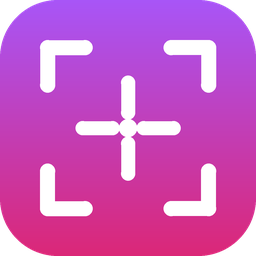
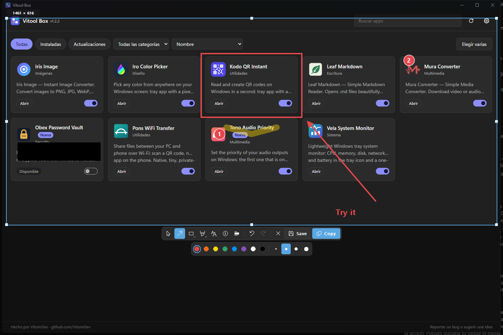

<p align="center"></p>

# 📸 FlashShot — Screen Capture
[](https://opensource.org/licenses/MIT)

Press a key, drag over part of the screen, mark it up and copy or save it. ⚡  
No editor window to open, no account, no upload: everything happens right on top of the frozen screen and stays on your PC.

<p align="center"></p>

---

## 🚀 Features

- ⌨️ **One shortcut from any app**: Print Screen by default, change it in Settings
- 🧊 **Frozen screen**: the desktop is captured first, so videos and animations stop while you select
- 🖥️ **Every monitor**: selections can cross screens, also with monitors left of or above the main one and different scaling
- ✂️ **Precise region**: drag in any direction, resize from the corners and edges, move it with the mouse or one pixel at a time with the arrow keys, live size in pixels
- ✏️ **Annotations that stay editable** until you export: select, move, resize, recolor or delete any of them
  - ↗️ Arrow · ➖ Line · ▭ Rectangle · ◯ Ellipse (Shift for 45° steps, squares and circles)
  - 🖊️ Pen · 🖍️ Marker (see-through, never darker where it crosses itself)
  - 🔤 Text (multi-line, size, color, optional background) · 1️⃣ Numbering (1, 2, 3… per capture)
  - ⬛ Censor: an opaque box; the hidden pixels are not in the exported image at all
- ↩️ **Undo and redo** for every drawing, move, resize, style change or text edit, numbers included
- 📋 **Copy** (Ctrl+C) puts the image on the clipboard, ready to paste anywhere
- 💾 **Save** as PNG or JPEG with the usual Windows dialog, or **Ctrl+S** to save straight to the last folder with a dated name
- ⚡ **Ctrl+drag** copies the region the moment you release the mouse
- 🎨 Remembers each tool's color and size
- 🔒 100% offline: nothing leaves your PC. No telemetry, no accounts
- 🌙 Windows 11 look that follows your light or dark theme and accent color
- 🪶 Tiny: a ~0.4 MB program, no .NET or Visual C++ runtime needed, ~0 CPU while waiting
- 🚦 Starts with Windows (you can turn it off)

---

## 📦 Install

Download `FlashShotSetup.exe` from [Releases](https://github.com/VitomDev/FlashShot-Screen-Capture/releases/latest) and run it.

> 🧰 **Recommended:** install it with [Vitool Box](https://github.com/VitomDev/Vitool-Box), which keeps all VitomDev apps in one place and installs or removes them with a switch.

- Per-user install, no admin rights needed
- FlashShot opens a small window with **New capture** and **Settings**, then keeps running in the notification area
- It starts with Windows from then on

> 💡 **Print Screen busy?** Windows 11 can use Print Screen for its Snipping Tool, and other capture apps take it too. FlashShot tells you when that happens: turn that option off in *Windows Settings → Accessibility → Keyboard*, close the other app, or pick another shortcut in FlashShot's Settings.

Uninstalling (Settings → Apps) removes FlashShot, its startup entry and its settings.

---

## 🖱️ Usage

| Action | How |
| --- | --- |
| New capture | Print Screen, the tray icon, or **New capture** in FlashShot's window |
| Select a region | Drag anywhere; Esc closes the capture |
| Resize / move the region | Drag its corners or edges / drag inside it with the Select tool, or use the arrow keys |
| Copy as soon as you release | Hold Ctrl while dragging the region |
| Draw | Pick a tool and drag inside the region |
| Edit an annotation | Select tool (V): click it, drag it or its handles, change its color or size |
| Edit a text again | Double-click it |
| Finish a text | Click elsewhere or Ctrl+Enter (Esc cancels the edit) |
| Delete an annotation | Select it and press Delete |
| Undo / redo | Ctrl+Z / Ctrl+Shift+Z |
| Copy and close | Ctrl+C or **Copy** |
| Save | **Save** (choose where) or Ctrl+S (last folder, never overwrites) |
| Settings | Tray icon → **Settings**, or the **Settings** button |

### ⌨️ Tool keys

| Key | Tool | Key | Tool |
| --- | --- | --- | --- |
| V | Select | P | Pen |
| A | Arrow | M | Marker |
| L | Line | T | Text |
| R | Rectangle | N | Numbering |
| E | Ellipse | X | Censor |

Shapes and Draw are grouped on the toolbar: click the active group again to switch between its tools.

---

## 🔧 Build

Requirements: Visual Studio 2022 or newer with the C++ x64 tools and Inno Setup 6 (`winget install JRSoftware.InnoSetup`).

```powershell
.\build.ps1
```

It downloads the pinned build tools into `.deps/` (Windows SDK, CMake and Ninja, all verified by hash), builds everything, runs the tests and writes the installer to `dist/FlashShotSetup.exe`.

`.\build.ps1 -SkipTests` and `.\build.ps1 -SkipInstaller` skip those steps.

---

## 📚 Dependencies

None: FlashShot only uses Windows' own APIs (GDI and GDI+ for drawing, the Windows Imaging Component for PNG and JPEG, the standard clipboard and file dialogs). 🧘

---

## 🪟 Compatibility

Windows 10 (version 1809 or newer) and Windows 11, 64-bit.

---

## 🧪 Project Status

✅ Stable.  
This project is fully functional as-is and ready to use.
Future updates to improve features or the interface are not ruled out.

---

## 📄 License

[MIT](LICENSE) © VitomDev

---

## 📲 Contact

Feel free to reach out or follow me:

- 🐙 GitHub: [@VitomDev](https://github.com/VitomDev)
- 🐦 Twitter/X: [@VitomDev](https://twitter.com/VitomDev)
- 🎮 Twitch: [@VitomDev](https://www.twitch.tv/VitomDev)
